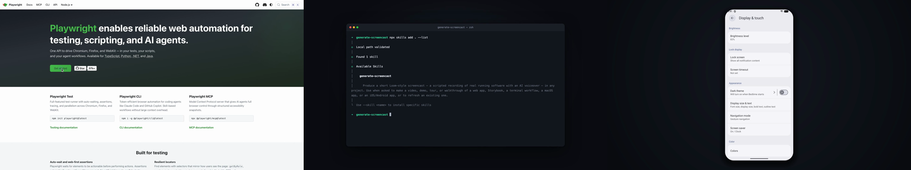

# generate-screencast

An agent skill that produces short, Loom-style screencasts of real running software: you approve a script, and the agent
records each scene on a timer, narrates it with text-to-speech, checks the frames, and hands you an MP4. Nobody has to
record their screen.

[](media/demo.mp4)

_The demo above was made with this skill (23s, [MP4](media/demo.mp4))._

## What it can film

| Surface                            | How                                                                           |
| ---------------------------------- | ----------------------------------------------------------------------------- |
| Web apps, local or deployed        | Playwright, with an injected cursor and click ripples; one-time headed login for authenticated pages |
| Storybook                          | Playwright, plus selector notes for the Storybook 8–10 manager UI             |
| Terminal workflows                 | Real command output, curated and replayed on a styled terminal stage          |
| macOS apps                         | ffmpeg screen capture cropped to the app window; real mouse and keyboard via a small CoreGraphics driver |
| iOS Simulator                      | `simctl` framebuffer recording; taps by clicking into the Simulator window    |
| Android emulator                   | `adb screenrecord` and `adb shell input`                                      |
| Anything that can't be scripted    | Hybrid mode: you perform the actions while the narration plays and the agent cues you |

Mobile scenes are framed on a 16:9 stage so they cut together with desktop scenes, or the whole video can be portrait.

## Captions

Every video ships with captions: an `.srt` file beside the MP4, and a subtitle track inside it that QuickTime, VLC and
most players can switch on. Captions show the script's real spelling, even where the narration needed phonetic help
("pnpm", not "P N P M"), and for your own narration they follow what you actually said, word by word.

For Slack, LinkedIn and other feeds that autoplay muted, ask for **burned-in** captions as well. They're rendered with
Chromium and laid over the picture with ffmpeg's core `overlay` filter, so they work on any ffmpeg build, including
Homebrew's default one without libass.

## Install

With the [skills CLI](https://skills.sh):

```bash
npx skills add paulstraw/generate-screencast -g    # global, for every project
npx skills add paulstraw/generate-screencast       # this project only
```

Or by hand: clone the repo anywhere and link the skill folder into your agent's skills directory, e.g. for Claude Code:

```bash
git clone https://github.com/paulstraw/generate-screencast ~/dev/generate-screencast
ln -s ~/dev/generate-screencast/skills/generate-screencast ~/.claude/skills/generate-screencast
```

Then ask your agent for a video: _"make a 45-second walkthrough of the signup flow"_.

## Requirements

- **An agent that can look at images.** The skill checks recon screenshots and extracted frames before it writes or ships
  anything.
- `ffmpeg`, Node.js, and [`uv`](https://docs.astral.sh/uv/) (the narration runs `uvx edge-tts`). The agent checks for
  these and offers to install whatever is missing.
- Playwright and Chromium install once per machine into `~/.cache/generate-screencast/` (about 150MB with Playwright's
  browser cache), never into your project, so no lockfile is touched. Burned-in captions need them too, so a video made
  only of native scenes (macOS, iOS, Android) installs them when you ask for burn-in.
- **macOS apps and iOS:** macOS, Xcode Command Line Tools (to compile the input driver), and Screen Recording and
  Accessibility permission for the terminal or editor running your agent. iOS also needs Xcode and a simulator.
- **Android:** the Android SDK (`adb`, `emulator`) and an emulator.
- **Narrating it yourself:** `sox` for recording, and an Apple Silicon Mac for transcribing your takes with
  `mlx-whisper`.
- **Your face on camera** (with your own narration): macOS, Xcode Command Line Tools, and Camera permission for your
  terminal. The camera records during your voiceover takes and goes in as a Loom-style bubble or a fullscreen cut.

Tested on macOS with Claude Code. Web and terminal scenes should work wherever Playwright and ffmpeg run; the hybrid mode
is not yet tested.

## Things to know before you use it

- **Native scenes drive your real mouse and keyboard and record your real screen.** Keep your hands off the machine
  during macOS and iOS takes. Recordings are cropped to the target window, and a guard kills and deletes a take if
  anything else comes to the front. That reduces the risk, but you should still turn on Do Not Disturb and look over the
  result before sharing it.
- **The narration text is sent to Microsoft's online TTS service.** [edge-tts](https://github.com/rany2/edge-tts) uses
  the read-aloud endpoint behind Microsoft Edge. It needs no API key, but it's an unofficial use of that service, and it's
  unclear whether you have commercial rights to the generated audio. Don't put anything confidential in a script, and
  check your own requirements before using the audio in client or commercial work. Or narrate it yourself: a teleprompter
  records one take per beat, and nothing is sent anywhere.
- **The narration never claims anything the screen doesn't show.** If a scene needs something that doesn't exist yet,
  the agent proposes building it for real (with your approval) rather than faking it. Terminal output is real output
  with the noise removed, never invented.

## How it works

1. **Shape** — the agent interviews you about subject, audience, beats and where the project goes. It produces nothing
   until you approve the script word for word.
2. **Voiceover** — one clip per beat, from TTS or read by you. Each clip's measured length sets its scene's length.
3. **Film** — each scene is recorded on a clock, so actions land on the spoken words.
4. **QA** — the agent extracts frames across every scene and looks at them, then re-shoots anything that's wrong or
   shows something private. Each pass is recorded, so a later change to a beat sends it back through QA.
5. **Assemble** — [`assemble.mjs`](skills/generate-screencast/assets/assemble.mjs) renders the edit: each voiceover
   clip at a fixed offset computed from the measured durations, so timing errors don't accumulate, and each picture cut
   from its recording to match. Captions are placed by the same offsets, so they can't drift from the voice.

### A project per video

Each video is a folder (by default `~/Downloads/<slug>/`, or anywhere you name, including inside a repo) holding
everything about it: `screencast.json`, the single source of truth for every beat (script, voice, surface, camera,
captions, edit), `build.json` with what was built from what, the agent's `film.mjs` choreography, the voiceover, the
recordings, and the deliverables `<slug>.mp4`, `.srt` and `.script.md`. Beats have stable ids, so files are named after
them and reordering is just reordering the list. `status.mjs` compares the two JSON files and says, beat by beat, what
needs rebuilding and why ("text changed since the VO"), whoever made the change.

### Cuts and handles

By default each beat's picture changes exactly where its narration block starts. A beat can set a `cut` to move that
boundary while the audio stays put: an **L cut** brings the next screen in while the previous sentence finishes, a
**J cut** starts the next sentence over the previous screen. Every recording keeps a 1.5s **handle** of footage before
and after its scene, so cuts and the pauses around each line can move later without re-filming; push a cut past its
handle and `status` asks for a re-shoot.

### The editor

After the first render the agent offers a small local editor (`node skills/generate-screencast/assets/editor.mjs
<project>`): a browser page that previews the edit from the source media, using the same timeline code as the render.
In it you can drag cuts and lead/tail within the handles, reorder and skip beats, move the camera bubble and captions,
edit the text, flag beats for a re-shoot, a new voiceover or another QA look (with a note), and render. Tell the agent
when you're done; adding beats, new takes and filming stay with it.

### Refreshing a video

Weeks later, point the agent at the project folder and ask it to update the video. It runs `status`, which already
knows about any edits to `screencast.json`. Provenance can't see your app, though, so the agent also re-checks every
beat's screen against its last QA frames and flags the ones that changed. Then the same loop runs as for a fresh build:
only the beats whose script, edit or screen changed get a new voiceover, a re-shoot or another QA pass, and the video is
re-rendered.

See [`SKILL.md`](skills/generate-screencast/SKILL.md) for the full procedure and
[`references/`](skills/generate-screencast/references) for the per-surface recipes.

## Developing

The tests live in `test/` at the repo root, outside the skill folder the skills CLI installs. They need only Node and,
for the media tests, ffmpeg (skipped with a message when it's missing):

```bash
node --test test/*.test.mjs
```

## License

[MIT](LICENSE)
